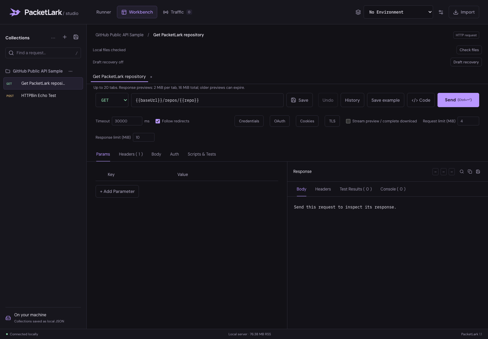

# Rea API Studio

A small, local API workbench with HTTP traffic capture and inferred OpenAPI exports. An independent MIT-licensed side project.



## Run locally

Requires **Node.js 22+** and npm.

```sh
git clone https://github.com/abrar225/rea-api-studio.git
cd rea-api-studio
npm ci
npm run build
npm start
```

Open **http://localhost:4040/studio** for the workbench or **http://localhost:4040/** for the product site. The services bind to `127.0.0.1`. Set `PORT` and `SNIFFER_PORT` to change the defaults (4040 and 8085). If a port is occupied, the service tries the next one; the interface reports the actual proxy port.

The website published on [GitHub Pages](https://abrar225.github.io/rea-api-studio/) contains a clearly labeled sample preview and installation instructions. **GitHub Pages cannot run the Node API or save local collections.**

## What works

- HTTP requests with query parameters, headers, JSON/text, URL-encoded and text multipart bodies.
- Bearer, Basic, and API-key authentication.
- Local collections, nested imported folders, environments, and variables.
- QuickJS-isolated pre-request JavaScript, Chai assertions, inherited scripts, async tests and a supported subset of `pm.*`.
- Redirect-aware cookie sessions, cancellation, response limits and original binary downloads.
- Origin-bound credential references, macOS Keychain or explicit session storage, OAuth PKCE/refresh/revoke, selected-file uploads, custom CA/mTLS, and bounded JSON Schema validation. See [P2 scope and platform limits](docs/P2_PROGRESS.md).
- Collection runner with JSON/CSV data, iterations, request chaining and CLI JSON/JUnit summaries.
- Stdio MCP tools and a packageable VS Code desktop preview; see [integrations](docs/INTEGRATIONS.md).
- Postman v2.1 collection import/export and basic cURL import.
- Response search, copy, download, and cURL/Fetch/Python/Go snippets.
- Forward HTTP traffic through a local proxy; inspect the last 500 records in memory.
- Infer JSON schemas and common path IDs; preview OpenAPI 3.1 JSON and a TypeScript client draft.

## Capture traffic

Forward to a target with the proxy's path format:

```sh
curl http://localhost:8085/https://httpbin.org/json
```

Or specify the target in a header:

```sh
curl http://localhost:8085/ -H 'X-Target-Url: https://httpbin.org/json'
```

For **plain HTTP targets**, a standard HTTP proxy request also works:

```sh
curl -x http://localhost:8085 http://example.com/
```

The proxy does **not** implement HTTPS CONNECT interception. `curl -x ... https://...` is not a supported capture workflow. The path/header format can forward to HTTPS targets, but does not intercept encrypted browser tunnels.

## Data and trust

Workspace data is stored under `.rea-api/collections/` and `.rea-api/environments/`. Canonical files are authoritative; legacy monolithic sources are retained for resumable migration and are not live mirrors. These files are readable JSON, not encrypted storage, and are ignored by Git by default. If you explicitly version collections, exclude credentials first; files do not make merge conflicts impossible. Existing tracked workspace examples from earlier releases are no longer tracked by this revision; local files are preserved.

Only one Studio may write a workspace at a time. Normal shutdown releases ownership; a hard exit requires reviewing `rea-api workspace status` and explicitly recovering the exited owner's token. See [workspace ownership and recovery](docs/WORKSPACE_OWNERSHIP.md) for commands, supported scope and maintenance details.

The workbench checks external file changes while preserving unsaved drafts and offers explicit conflict review/recovered copies. Browser Send/Run operations bind their selected context revisions. Current workspace limits are 1,000 resource documents and 32 MiB combined, with 2 MiB per resource. See [reconciliation behavior and limits](docs/WORKSPACE_RECONCILIATION.md); durable unsaved-draft recovery remains unfinished.

After installation/build, fonts, icons, and scripts are served locally. Calls to remote APIs still need a network connection. There is no implemented Rea telemetry service in this source tree.

Only run scripts and imported collection scripts whose network behavior you trust. The engine now uses a separate QuickJS interpreter with heap/stack/time limits and a narrow JSON bridge instead of Node object references. Scripts can still make HTTP requests and change services; this is not a formal security certification. The server now rejects foreign browser origins and hosts, but it is not an authenticated multi-user server. Do not expose it publicly. Inspection captures are bounded and sanitized before retention; authorized forwarding preserves the request bytes. Redaction is not encryption or universal secret detection.

## Current limits

This is a focused local HTTP workbench, not a complete Postman replacement. Dedicated GraphQL/gRPC/WebSocket/MQTT clients, OAuth flow management, monitors, mocks, team sync, roles and cloud operations remain absent. Cookies and the collection runner are now implemented; the cookie jar is in-memory, without a persistent cookie editor.

Postman v2.1 import supports the tested HTTP subset, including inherited scripts/auth and normalized query parameters. Unsupported advanced body/auth modes are preserved with warnings and execution blocked. Full sandbox/Collection SDK compatibility and lossless round-tripping are not claimed. Inferred specs describe observations rather than complete contracts; select an origin to avoid conflating servers. Generated SDKs/snippets still need review.

Read [current readiness and launch gates](docs/PLATFORM_READINESS.md), [Postman research provenance](docs/POSTMAN_RESEARCH.md), and [CLI/editor/agent setup](docs/INTEGRATIONS.md).

See the [product assessment](docs/PRODUCT_ASSESSMENT.md) for evidence, a broad capability inventory, weighted ratings, and priorities. The original speed/memory comparisons with Postman were not reproducible benchmarks and have been removed. Server RSS excludes browser memory.

## Development and checks

```sh
npm run check        # TypeScript + local web bundles + all tests
npm audit            # Dependency audit; results vary with advisory updates
npm run dev          # Build, then restart server when dist changes
npm run build:web    # Rebundle frontend after changing web/*
```

Tests use real loopback HTTP fixtures and temporary workspaces. They do not depend on a public echo service or modify your `.rea-api` directory. Frontend CSS and the existing application logic are separate from `studio.html`; editing `public/app.js` or the hand-authored CSS takes effect on reload. Rebuild after changing bundled modules or server TypeScript.

`node scripts/assessment-probes.mjs` now gates the formerly reproduced import/spec defects. It is a focused regression probe, not full Postman conformance.

GitHub Actions builds and tests Node 22 and 24. A separate workflow publishes **only `dist-site/`** to GitHub Pages on updates to `main`.

## Design

[DESIGN.md](DESIGN.md) documents the reference research, chosen palette, original SVG logo, type system, responsive layout, and motion rules. GSAP handles the homepage intro and product reveal, Lenis handles homepage scrolling, and Anime.js handles user-triggered sample/metric transitions. Reduced-motion preferences disable decorative motion. The workbench retains native scrolling.

The reference sites are inspiration, not assets copied into the product. The identity is original vector work; similarity/trademark clearance has not been performed. Third-party package licenses, including GSAP's own license, are listed in [third-party notices](docs/THIRD_PARTY_NOTICES.md).

## License

[MIT](LICENSE) for this project's source. Third-party libraries and fonts retain their respective licenses.
